  

  
  
  

  

## 📊 Em números

  

## 👋 Quem sou eu

Sou formado em Análise e Desenvolvimento de Sistemas e trabalho com **SEO técnico para e-commerces**. Sei como um site é construído, e isso muda a qualidade do diagnóstico: eu enxergo o problema de indexação ou de performance na raiz e converso de igual para igual com quem desenvolve. Quando uma tarefa se repete, eu escrevo um script em Python.

Antes disso, passei dois anos na equipe de desenvolvimento da **Prefeitura de Maringá** (via AmTech), entregando portais públicos, dashboards em tempo real e automações.

## 🧭 Como eu trabalho

  

<table>
<tr>
<td width="50%" valign="top">

### 🔎 SEO técnico
Atuo em contas de e-commerce de grande porte, em plataformas como VTEX, Shopify, Nuvemshop e WordPress.

- Diagnóstico de indexação e rastreabilidade
- Canonical, redirecionamentos e paginação
- Dados estruturados e performance (Core Web Vitals)
- Documentação das tarefas e alinhamento com times de desenvolvimento e conteúdo

</td>
<td width="50%" valign="top">

### 🐍 Desenvolvimento e automação
Uso programação para ganhar escala no trabalho de SEO e nos meus projetos.

- Scripts em Python para tratamento de dados e tarefas repetitivas
- Integração de APIs REST
- Interfaces web com React e Next.js
- Banco de dados com SQL

</td>
</tr>
</table>

## 🧰 Stack

  
  
  
  
  
  
  
  

## 🏛️ Entregas na Prefeitura de Maringá

Foram projetos de governo, com código de propriedade institucional, por isso não há repositórios públicos. Clique em cada um para ver o que eu construí.

<b>📡 Maringá Conectada</b> · monitoramento em tempo real · <code>-40% no tempo de resposta do suporte</code>

 

Desenvolvimento **full-stack** de um sistema de monitoramento: dashboards interativos e lógica de alertas em tempo real. O resultado foi uma redução de **40% no tempo de resposta do suporte**.

**Tecnologias:** React, Python, APIs

<b>🎪 Maringá Encantada e Portal de Eventos</b> · front-end de alto tráfego

 

Front-end completo em **React e Next.js**, pensado para suportar alto volume de acessos, além do dashboard administrativo do portal de eventos.

**Tecnologias:** React, Next.js, JavaScript, UI/UX

<b>🩺 Portal de Editais da Residência Médica</b> · foco em usabilidade

 

Interface criada para o cidadão encontrar e acompanhar os editais sem atrito, com foco em usabilidade.

**Tecnologias:** HTML, CSS, JavaScript, UI/UX

<b>🗳️ Votação segura e bots do SENAI</b> · back-end e automação

 

Back-end escalável em **Python** para um sistema de votação, com relatórios via API, e bots de automação para a captação de alunos do SENAI.

**Tecnologias:** Python, APIs REST, SQL

## 🛤️ Trajetória

  

## 🚗 Projeto pessoal: Zanin Detailer

Aplicação de agendamento e gestão para o meu próprio negócio de estética automotiva. É onde eu aplico UI/UX, React e automações de back-end em um problema real, com cliente real.

<!-- Quando o repositório do Zanin Detailer estiver público, adicione aqui o link e um print ou GIF da tela principal. -->

<b>📈 Atividade no GitHub</b>

 

  

## 🤝 Vamos conversar

Estou aberto a oportunidades que combinem **desenvolvimento em Python e React** ou **SEO técnico com automação**, de preferência em empresas com plano de carreira.

  
  

